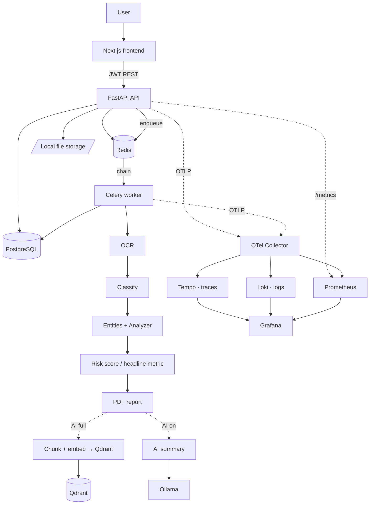

# ClearClause — Document Risk Intelligence Platform

**Understand exactly what you're agreeing to.** ClearClause reviews financial and
property documents for hidden fees, penalties, traps, and missing protections — and
explains every risk in plain English, with a downloadable PDF report and optional,
fully-local AI summaries and grounded Q&A.

Upload a PDF or image → it reads the text, **classifies the document**, extracts
structured **entities**, runs a **type-specific analyzer**, scores the risk, generates a
professional report, and (optionally) indexes it for **retrieval-grounded Q&A**. The
intelligence is **deterministic-first** — every finding traces to specific wording; AI
only rephrases and answers over those grounded facts, never invents them.

**Document families**

| Consumer | Property |
|---|---|
| Loan · Subscription · Credit card | Patta · Sale deed · Rental / Lease agreement |

---

## Why this matters

Consumers routinely agree to financial terms they don't fully understand — hidden
processing fees deducted upfront, late-payment penalties, prepayment/foreclosure charges,
free-trial auto-renewals, bundled insurance, and "deemed consent" clauses. Regulatory and
consumer-protection pressure increasingly emphasises transparent fees, clear borrower
disclosures, explicit consent, and fewer dark patterns. ClearClause puts that scrutiny in
the consumer's hands before they sign.

## Features

- Secure upload (PDF / PNG / JPG) with content-sniffing validation
- **Automatic, staged pipeline** (Celery chain across queues) — analysis starts on upload
- Free, local-first OCR (Tesseract) behind a pluggable provider interface
- **Document classification** (rule-based, pluggable) into 8 types
- **Structured entity extraction** per document family
- **Type-specific analyzers** with their own headline metric (Rental Fairness, Patta
  Health, Sale Agreement Risk, Card Terms Transparency, fee-weighted loan/subscription risk)
- Explainable findings: what was found · why it matters · where it appears · what to do
- **Purpose-built PDF report** (cover, executive summary, clause analysis, cost impact, …)
- **Optional local AI (V3):** grounded summaries + retrieval-grounded Q&A with citations
  (Ollama + Qdrant) — off by default; V1/V2 work fully without it
- Per-user scan history, ownership-enforced access, document deletion
- Full observability: traces, metrics, logs + Grafana dashboards (API, pipeline, platform)

See **[docs/V2_V3_PLAN.md](docs/V2_V3_PLAN.md)** for the platform architecture & evolution plan.

## Architecture

A **modular monolith with a separate worker** — clean module boundaries without
microservice overhead.



**Pipeline:** Upload → OCR → Clause extraction → Risk detection → Scoring → Report.

## Stack

| Layer | Choice | Why |
|---|---|---|
| Frontend | Next.js + TypeScript + Tailwind + Framer Motion | Modern, fast, premium UI |
| API | FastAPI + SQLAlchemy 2.0 + Pydantic v2 | Async, clean, great for OCR/rules |
| Worker | Celery + Redis | Proven async document processing |
| Database | PostgreSQL (Alembic migrations) | Production-standard relational store |
| Cache / queue | Redis | Job queue + rate limiting |
| OCR | Tesseract (PaddleOCR adapter stub) | Free, CPU-only, pluggable |
| Reports | ReportLab | Purpose-built PDF, not HTML-to-PDF |
| AI (optional) | Ollama (qwen3 / gemma3) + Qdrant | Local, private LLM + vector search |
| Observability | OpenTelemetry + Prometheus + Loki + Tempo + Grafana | Fully open-source |
| CI/CD | GitHub Actions | Lint, test, build, GHCR |

Everything is free and runs locally via Docker Compose.

## Quick start

```bash
cp .env.example .env
docker compose up --build
docker compose exec backend alembic upgrade head   # once db is healthy
docker compose exec backend python scripts/seed.py # optional: 6 demo documents
```

With the observability stack:

```bash
docker compose -f docker-compose.yml -f infra/docker-compose.obs.yml up --build
```

### With local AI (RAG summaries + grounded Q&A) — optional

AI is **off by default**; V1/V2 work fully without it. To enable the local,
private AI layer (Ollama + Qdrant — downloads a few GB of models):

```bash
docker compose --profile ai up -d ollama qdrant
docker compose exec ollama ollama pull nomic-embed-text   # embeddings (~270 MB)
docker compose exec ollama ollama pull qwen3:8b           # LLM (or gemma3:4b, smaller)
# set AI_MODE=full in .env, then recreate the app:
docker compose up -d --force-recreate backend worker
```

Re-upload a document (or `POST /api/v1/documents/{id}/reprocess`). The detail page
then shows an **AI summary** and an **Ask-about-this-document** chat with source
citations. `AI_MODE=summary_only` enables summaries without Q&A. Every AI output is
grounded strictly in the deterministic findings/clauses — no outside facts, and Q&A
refuses when retrieval finds nothing.

| Service | URL |
|---|---|
| Frontend | http://localhost:3000 |
| API docs | http://localhost:8000/docs |
| API health | http://localhost:8000/health |
| API metrics | http://localhost:8000/metrics |
| Grafana | http://localhost:3001 (admin / admin) |
| Prometheus | http://localhost:9090 |

Demo login after seeding: **demo@example.com / supersecret1**.
See [docs/DEMO.md](docs/DEMO.md) for a guided walkthrough.

## Tests

```bash
docker compose exec backend python -m pytest -q     # 38 tests
docker compose exec frontend npx tsc --noEmit
```

Unit (OCR, rules, scoring, report, security), integration (full pipeline, DB, real OCR),
and end-to-end on the 6 seeded sample documents.

## Screenshots

Add captures to `docs/screenshots/` — referenced here:

| | |
|---|---|
| Landing | `docs/screenshots/landing.png` |
| Processing | `docs/screenshots/processing.png` |
| Findings | `docs/screenshots/findings.png` |
| PDF report | `docs/screenshots/report.png` |
| Grafana | `docs/screenshots/grafana.png` |

## Trade-offs

- **Modular monolith + one worker**, not microservices/Kafka — right-sized for the scope.
- **Rule engine over an LLM** — explainable and free; every finding cites the clause.
  Ceiling: nuanced wording an LLM might catch is out of scope (see roadmap).
- **Tesseract** for OCR — light and free; a PaddleOCR adapter stub exists for harder layouts.
- **True-cost** sums stated currency amounts; percentages are shown but not compounded
  (no reliable principal). 
- **Local filesystem** storage with a retention sweep — swap for S3/MinIO to scale.
- One overview Grafana dashboard wired across all three signals (others are quick to add).

## Roadmap

- PaddleOCR for harder layouts · S3/MinIO storage · side-by-side document compare
- Browser-extension capture at checkout · multi-language OCR
- LLM-assisted explanations layered *on top of* (not replacing) the rule engine
- Split the worker into dedicated services if throughput grows

> Informational analysis only — not legal or financial advice.
