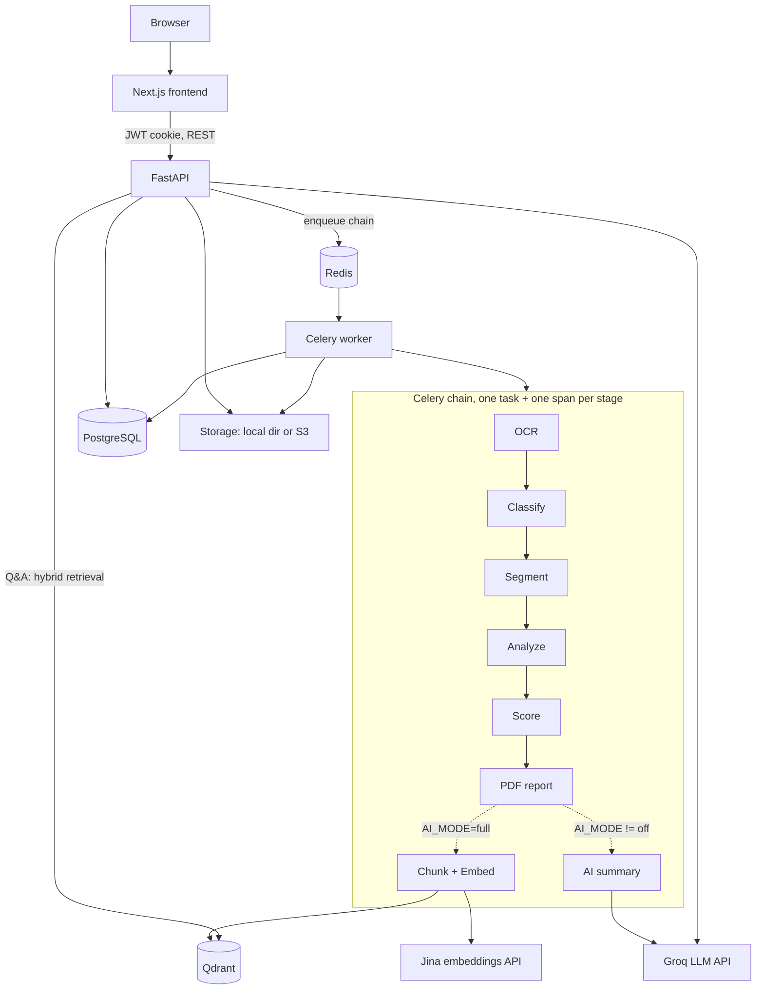

# ClearClause

**Document risk intelligence for consumer finance and property agreements.**

ClearClause reads a loan, subscription, credit-card, rental, sale-deed, or patta document and
reports what it actually commits you to — hidden fees, penalties, auto-renewals, missing
protections — with every finding traced back to the exact wording that produced it.

> **Status:** Active development. The full pipeline (upload → OCR → classification → analysis →
> scoring → PDF report) is implemented and covered by 130 backend tests. The AI layer
> (summaries + retrieval-grounded Q&A) is implemented but **disabled by default** and requires
> third-party API keys.

---

## Overview

Consumers agree to terms they haven't read and couldn't parse if they had: processing fees
deducted from the disbursed amount, foreclosure charges, free trials that convert silently,
lock-in periods, deposits that are never coming back. The information is in the document; it is
simply unreadable.

ClearClause is **deterministic-first**. A rule engine and per-type analyzers are the source of
truth — every finding cites the clause that triggered it, and the same document always yields the
same findings. The LLM layer is strictly downstream: it rephrases and answers questions *over*
those grounded facts. It cannot introduce a finding, and Q&A refuses to answer when retrieval
returns nothing relevant.

That inversion — rules decide, the model explains — is the difference from a general "ask an LLM
about your PDF" tool, which can neither guarantee reproducibility nor show you why it said what it
said.

**Built for** individuals reviewing an agreement before signing, and as a reference
implementation of a document-analysis pipeline with an auditable AI layer.

---

## Key Features

**Document processing**

- Upload PDF / PNG / JPEG, validated by magic-byte sniffing (not file extension), with size and
  page-count caps.
- OCR with two providers: `auto` reads the PDF text layer and only rasterizes pages that lack one;
  `tesseract` forces OCR on every page. Mean OCR confidence is recorded and surfaced when low.
- Analysis dispatches automatically on upload — no separate "analyze" step.

**Analysis**

- Rule-based classifier over 26 document types (weighted keyword signals + filename hints),
  producing a confidence score and a routing action: `auto`, `confirm` (alternatives shown to the
  user), or `manual`. Classification is user-correctable via `PATCH /classification`.
- Six type-specific analyzers — loan, subscription, credit card, rental, sale deed, patta — each
  with its own entity extractor and headline metric. Unregistered types fall back to the shared V1
  rule engine.
- Structured entity extraction (interest rate, processing fee, deposit, survey number, …).
- Risk scoring and a cost breakdown of upfront, recurring, and penalty amounts.
- Every finding carries: what was found, why it matters, where it appears, and what to do.

**Presentation**

- Interactive Document Explorer with five views — Overview, Financial, Timeline, Sections,
  Questions — plus a guided walkthrough.
- Generated PDF report (ReportLab, purpose-built layout: cover, executive summary, per-finding
  analysis, cost impact).
- Per-user scan history; documents are private to their owner.

**AI layer** *(optional, off by default — see [Configuration](#configuration))*

- Grounded document summary (`AI_MODE=summary_only`).
- Retrieval-grounded Q&A with page/section citations and follow-up suggestions (`AI_MODE=full`).
- Hybrid retrieval: BM25 + vector search fused with Reciprocal Rank Fusion, plus SQL entity lookup
  for factual questions and a 26-entry knowledge pack of RBI / IRDAI / RERA / Consumer Protection
  regulations, routed by rule-based intent detection.

**Platform**

- JWT auth in httpOnly cookies, with refresh-token rotation and revocation, and per-account login
  lockout.
- Sentry error reporting, OpenTelemetry traces, Prometheus metrics with Alertmanager
  routing, Loki logs, Grafana dashboards.
- Production Compose stack with Caddy (automatic TLS), S3-compatible object storage, and a
  scaled-out worker.

---

## Architecture

A modular monolith plus a separate Celery worker. Clean module boundaries, no microservice tax.



**Layering** (`backend/app/`): `api/v1/` routes → `services/` (one per pipeline concern) →
`repositories/` (all persistence) → `models/` (SQLAlchemy). Stages communicate through Pydantic
contracts in `app/contracts/types.py`, not through each other's models. Worker tasks call the same
services as the API.

**Pipeline properties:** every stage is an independent, idempotent, retry-safe Celery task with its
own OTel span and status write. Repository writes are replace-by-document, so a retry or a
reprocess reproduces the same state. A stage failure marks the document `FAILED` and stops the
chain. Optional AI stages are *soft* — if Groq, Jina, or Qdrant is unreachable, the stage logs and
skips, leaving the already-complete document intact.

---

## Technology Stack

| Layer | Technology |
|---|---|
| Frontend | Next.js 15 (App Router), React 19, TypeScript 5.7 |
| Styling / animation | Tailwind CSS 3.4, Framer Motion 11, lucide-react |
| State management | React hooks and local component state (no external store) |
| API | FastAPI 0.115, Pydantic v2, SQLAlchemy 2.0 (async) |
| Worker | Celery 5.4 with embedded beat, Redis broker |
| Database | PostgreSQL 16, Alembic migrations |
| Cache / queue | Redis 7 (broker, rate limits, token revocation, login lockout) |
| Authentication | JWT (PyJWT, HS256) in httpOnly cookies, bcrypt password hashing |
| OCR | Tesseract (`pytesseract`), `pdfplumber` text layer, `pdf2image` |
| LLM | Groq API — default `llama-3.3-70b-versatile` |
| Embeddings | Jina AI API — `jina-embeddings-v3`, 768-dim |
| Vector search | Qdrant 1.12 |
| Retrieval | Hybrid BM25 + vector, fused with Reciprocal Rank Fusion (implemented in-repo) |
| Storage | Local directory (dev) or S3 / R2 / Spaces via boto3, SSE + signed URLs |
| Reports | ReportLab |
| Observability | Sentry, OpenTelemetry, Prometheus, Alertmanager, Loki, Tempo, Grafana |
| Deployment | Docker Compose; Caddy reverse proxy with automatic TLS |
| CI | GitHub Actions — ruff, pytest, tsc, ESLint, Docker build, Trivy scan |

> **Note:** the LLM and embedding models are reached over HTTP. There is no local model runtime and
> no heavy ML dependency in the image.

---

## Project Structure

```
backend/
  app/
    api/v1/          REST routes (auth, documents, analysis)
    services/        One per pipeline concern; orchestration
    repositories/    All persistence; one per model
    models/          SQLAlchemy models
    contracts/       Pydantic contracts — the stable seams between stages
    core/            Config, security, storage, rate limiting, lockout, revocation
    ocr/             Pluggable OCR providers (pdftext, tesseract)
    classification/  Rule-based document classifier
    segmentation/    Clause segmentation
    detection/       V1 rule engine (fallback for unrouted types)
    analysis/        Per-type analyzers + registry
    entities/        Per-type entity extractors
    scoring/         Risk score and cost breakdown
    reporting/       PDF report builder (ReportLab)
    rag/             Chunking, embeddings, Qdrant store, hybrid retriever, intent routing
    knowledge/       Static regulation knowledge packs
    ai/              LLM client, prompts, summarizer
    worker/          Celery app, tasks, pipeline chain
  alembic/versions/  Migrations
  tests/             130 tests: unit, integration, end-to-end
  scripts/seed.py    Seeds demo user + sample documents

frontend/
  app/               App Router pages: landing, login, register, dashboard,
                     documents/[id], sample, legal/*
  components/
    explorer/        Explorer tabs: Overview, Financial, Timeline, Sections, Questions
    ui/              Shared primitives
  lib/api.ts         Single REST client for the backend

infra/               Observability stack (OTel Collector, Prometheus, Alertmanager, Loki, Tempo, Grafana)
deploy/Caddyfile     Production reverse proxy / TLS
sample-data/         10 sample documents used by the seed script and E2E tests
docs/                Demo walkthrough and deployment guide
```

---

## Getting Started

### Prerequisites

Docker and Docker Compose. Nothing else — there is no supported bare-metal path.

### Installation

```bash
git clone https://github.com/mithunveluru/clearclause.git
cd clearclause
cp .env.example .env
docker compose up --build
```

### Database setup

Once the `db` container is healthy:

```bash
docker compose exec backend alembic upgrade head
docker compose exec backend python scripts/seed.py   # optional: demo user + sample documents
```

The seed script creates a local demo account (`demo@example.com` / `supersecret1`, override
with `SEED_EMAIL` / `SEED_PASSWORD`) and uploads the documents in `sample-data/`. It is a
development convenience and has no effect on a deployed instance.

### Services

| Service | URL |
|---|---|
| Frontend | http://localhost:3000 |
| API docs (OpenAPI) | http://localhost:8000/docs |
| Health check | http://localhost:8000/health |

### Enabling the AI layer (optional)

The AI layer is off by default; everything else works fully without it. It requires a
[Groq](https://console.groq.com) API key (LLM) and a [Jina AI](https://jina.ai) API key
(embeddings), and Qdrant for vector search.

```bash
# in .env:
#   AI_MODE=full
#   GROQ_API_KEY=...
#   JINA_API_KEY=...

docker compose --profile ai up -d qdrant
docker compose up -d --force-recreate backend worker
```

Then re-upload a document, or `POST /api/v1/documents/{id}/reprocess`. The document page will show
an AI summary and an "ask about this document" panel with source citations.
`AI_MODE=summary_only` enables summaries without Q&A (no Qdrant needed).

### With the observability stack

```bash
docker compose -f docker-compose.yml -f infra/docker-compose.obs.yml up --build
```

Grafana at http://localhost:3001, Prometheus at http://localhost:9090, Alertmanager at
http://localhost:9093.

### Tests and lint

```bash
docker compose exec backend python -m pytest -q       # 130 tests
docker exec clearclause-frontend-1 sh -c 'npx tsc --noEmit && npm run lint'
```

Backend linting is ruff, pinned to 0.8.4. It is not installed in the backend image — it runs via
pre-commit locally and is installed directly in CI:

```bash
pre-commit install          # then ruff runs on every commit touching backend/
```

> **Note:** `frontend/node_modules` and `.next` on the host are root-owned (seeded by an anonymous
> Docker volume), so running `npm ci` / `npm run build` directly on the host fails with `EACCES`.
> Use the container.

### Production

`docker-compose.prod.yml` builds real images (no bind mounts, no `--reload`), runs migrations as a
one-shot service, keeps datastores off host ports, terminates TLS at Caddy, and puts uploads in
object storage so the API and worker share no filesystem and the worker can scale out.

```bash
cp .env.production.example .env.production   # then fill it in
docker compose -f docker-compose.prod.yml --env-file .env.production up -d
```

With `ENV=production`, the application **refuses to start** unless `JWT_SECRET` has been changed
from its default, `COOKIE_SECURE=true`, and all CORS origins are `https://`. The check lives in
settings validation, so it covers the API, the worker, and Alembic alike.

See [docs/deploy-vps.md](docs/deploy-vps.md) for the full procedure.

### Hosted (Vercel + Render)

[docs/deploy-render.md](docs/deploy-render.md) covers a managed deploy — Next.js on Vercel, the API and
worker on Render, documents in Cloudflare R2 — including the free tier's real limits (spin-down,
512 MB shared between the API and the worker, and a Postgres instance that expires after 30 days).

---

## Configuration

All configuration is environment-based; see `.env.example`.

### Core

| Variable | Default | Purpose |
|---|---|---|
| `DATABASE_URL` | `postgresql+asyncpg://…@db:5432/clearclause` | Postgres DSN (async driver) |
| `REDIS_URL` | `redis://redis:6379/0` | Broker, rate limits, token revocation, lockout |
| `JWT_SECRET` | `change-me-in-prod` | Token signing key. **Must be changed in production.** |
| `CORS_ORIGINS` | `http://localhost:3000` | Comma-separated allowed origins |
| `NEXT_PUBLIC_API_BASE_URL` | `http://localhost:8000` | Backend base URL, read by the frontend |

### Uploads and OCR

| Variable | Default | Purpose |
|---|---|---|
| `OCR_PROVIDER` | `auto` | `auto` = PDF text layer first, OCR only scanned pages. `tesseract` = OCR every page. |
| `OCR_LOW_CONFIDENCE` | `60` | Mean OCR confidence (0–100) below which the user is warned |
| `MAX_UPLOAD_MB` | `10` | Byte-size cap per upload |
| `MAX_PDF_PAGES` | `50` | Page cap — a small compressed PDF can hold thousands of pages, and OCR memory scales with page count, not file size |
| `FILE_RETENTION_DAYS` | `7` | Age after which the daily cleanup task deletes documents and files |

### Storage

| Variable | Default | Purpose |
|---|---|---|
| `STORAGE_BACKEND` | `local` | `local` = a plain directory (dev/test only: unencrypted, unbacked). `s3` = S3/R2/Spaces, encrypted at rest, reports served by signed URL. |
| `STORAGE_DIR` | `/storage` | Root for the `local` backend |
| `S3_BUCKET` / `S3_REGION` | — | Required when `STORAGE_BACKEND=s3` |
| `S3_ENDPOINT_URL` | — | Set for R2 / Spaces / MinIO; leave blank for AWS |

AWS credentials are read from the standard environment (`AWS_ACCESS_KEY_ID`,
`AWS_SECRET_ACCESS_KEY`) by boto3 — they are not application settings.

### Deployment

| Variable | Default | Purpose |
|---|---|---|
| `ENV` | `development` | `production` activates the startup invariant checks described above |
| `COOKIE_SECURE` | `false` | `true` over HTTPS — sets the `Secure` flag on auth cookies |
| `TRUSTED_PROXY_DEPTH` | `0` | Number of trusted proxy hops. `0` = direct. Behind a load balancer this must be set, or every request appears to come from the LB and one user's traffic rate-limits everyone. |
| `METRICS_TOKEN` | — | When non-empty, exposes `/internal/metrics` behind an `X-Metrics-Token` header |
| `OTEL_EXPORTER_OTLP_ENDPOINT` | — | OTLP collector endpoint; telemetry is a no-op when unset |

### Classification and AI

| Variable | Default | Purpose |
|---|---|---|
| `CLASSIFICATION_AUTO_THRESHOLD` | `0.90` | At or above this confidence, classification proceeds automatically |
| `CLASSIFICATION_CONFIRM_THRESHOLD` | `0.70` | At or above this, alternatives are surfaced for confirmation; below it, the user picks manually |
| `AI_MODE` | `off` | `off` \| `summary_only` \| `full`. `full` adds chunking, embedding, and Q&A. |
| `AI_MODEL` | `llama-3.3-70b-versatile` | Groq model id |
| `GROQ_API_KEY` | — | Required unless `AI_MODE=off` |
| `JINA_API_KEY` | — | Required unless `AI_MODE=off` |
| `QDRANT_URL` | `http://qdrant:6333` | Vector store; only used when `AI_MODE=full` |

---

## How It Works

```
Upload  →  OCR  →  Classify  →  Segment  →  Analyze  →  Score  →  Report
                                                                     │
                                              AI_MODE=full ──────────┤
                                                                     ↓
                                                          Chunk → Embed → Qdrant
                                              AI_MODE != off ────────┤
                                                                     ↓
                                                              AI summary
```

1. **Upload.** The file is sniffed by magic bytes, size- and page-capped, written to storage, and a
   Celery chain is dispatched immediately.
2. **OCR.** The PDF text layer is read where present; only pages without one are rasterized and run
   through Tesseract. Mean confidence is recorded.
3. **Classify.** Weighted keyword signals and filename hints produce a type, a confidence, and a
   routing action. Low confidence surfaces alternatives to the user rather than guessing.
4. **Segment.** The text is split into clauses with page and section provenance.
5. **Analyze.** The classified type selects an analyzer, which extracts structured entities and
   emits findings — each bound to the clause that produced it. Unrouted types fall back to the V1
   rule engine.
6. **Score.** A risk score, a risk band, and a cost breakdown (upfront / recurring / penalties).
7. **Report.** A PDF is generated and stored; it is served by signed URL from object storage, or
   streamed from disk in local mode.
8. **Explore.** The frontend renders the Explorer — Overview, Financial, Timeline, Sections,
   Questions — over the same findings.
9. **Ask.** *(AI_MODE=full)* A question is routed by intent — `structured` (SQL entity lookup),
   `knowledge` (regulation packs), or `semantic` — then answered from BM25 + vector retrieval over
   the document's own chunks, with citations. If retrieval returns nothing, the service says so
   instead of answering.

---

## Security

Implemented:

- **Authentication.** Bcrypt password hashing. JWTs (HS256): a 30-minute access token and a 7-day
  refresh token, both in `httpOnly`, `SameSite=Lax` cookies. The refresh cookie is path-scoped to
  `/api/v1/auth`, so it never travels with ordinary API calls.
- **Session revocation.** Refresh tokens rotate on use, and the presented token is revoked so it
  cannot be replayed. Logout revokes server-side — without this, logout only discarded the client's
  copy and a stolen token stayed valid for its full 7 days. Revoked JTIs are held in Redis only
  until natural expiry. This path **fails closed**: if revocation cannot be verified, the token is
  refused.
- **Authorization.** Every document route is ownership-scoped at the repository layer, and covered
  by a dedicated authorization test suite.
- **Rate limiting.** Fixed-window Redis limiter keyed on the real client IP (honoring
  `X-Forwarded-For` only up to `TRUSTED_PROXY_DEPTH` hops): register 5/min, login 10/min, refresh
  5/min, upload 30/min, Q&A 20/min. This path **fails open** — a Redis outage must not take down
  login — and increments a degradation counter when it does.
- **Login lockout.** Per-account failure counting (10 failures / 15 minutes), because an IP-keyed
  limiter does nothing against credential stuffing spread across many IPs at one account.
- **Upload validation.** Magic-byte content sniffing (the extension is never trusted), byte-size
  cap, and an independent page-count cap.
- **Security headers.** `Content-Security-Policy` (`default-src 'none'`), `X-Frame-Options: DENY`,
  `X-Content-Type-Options: nosniff`, `Referrer-Policy`, and HSTS when serving over HTTPS.
- **Log redaction** of sensitive values.
- **Production invariants.** The app refuses to start with `ENV=production` if the JWT secret is
  still the default, cookies are not `Secure`, or a CORS origin is plaintext HTTP.
- **Metrics are not public** — `/internal/metrics` requires a token.
- **Data retention.** A daily Celery beat task deletes documents past `FILE_RETENTION_DAYS`, purges
  their vectors, and sweeps unreferenced files.
- **Encryption at rest** on S3 (SSE-AES256); reports are served by short-lived signed URLs.

Not implemented: MFA, email verification, password reset, audit logging, per-tenant isolation.

---

## Performance

- **Background workers.** All document processing runs off the request path in a Celery chain
  across dedicated queues (`ocr_queue`, `analysis_queue`, `report_queue`, `ai_queue`). Upload
  returns as soon as the file is persisted.
- **Selective OCR.** `OCR_PROVIDER=auto` reads the existing PDF text layer and only rasterizes
  pages that lack one — the common case skips OCR entirely.
- **Retry discipline.** Stages retry transient failures with backoff, but never retry a soft
  time-limit breach: a document that blew the limit will blow it again, and retrying turns one
  doomed task into three while everyone else queues behind it.
- **Graceful AI degradation.** AI stages are soft-failing, so an outage at Groq, Jina, or Qdrant
  costs the summary, not the document.
- **Signed-URL report delivery.** Object storage serves the PDF bytes directly instead of streaming
  them through the API.
- **Async I/O throughout** the API (FastAPI + SQLAlchemy async); blocking LLM and embedding HTTP
  calls are pushed to threads so they don't stall the event loop.
- **Frontend.** Next.js App Router with route-level code splitting and skeleton loading states.

Not implemented: response caching, list virtualization, streamed LLM responses.

---

## Roadmap

Planned, not built:

- Streaming Q&A responses and a persistent conversational assistant (today each question is
  independent).
- Analyzers for the remaining classified types — insurance policies, employment letters, utility
  bills — which currently fall back to the V1 rule engine.
- Local / offline LLM inference, so no document text leaves the host.
- Side-by-side document comparison.
- Multi-language OCR.
- Splitting the worker into per-queue services if throughput demands it.

---

## Contributing

Issues and pull requests are welcome.

1. Fork and branch from `main`.
2. Keep changes surgical — match the surrounding style, and don't refactor adjacent code.
3. Add tests for behavior you change. New rules, analyzers, and extractors need coverage.
4. Ensure CI passes locally:
   ```bash
   pre-commit run --all-files                    # ruff
   docker compose exec backend python -m pytest -q
   docker exec clearclause-frontend-1 sh -c 'npx tsc --noEmit && npm run lint'
   ```
5. Schema changes need an Alembic migration (`alembic revision --autogenerate -m "…"`).

The project's guiding constraint: **the rule engine is the source of truth.** A change that lets
the LLM originate a finding, rather than explain one, will not be merged.

---

## License

[MIT](LICENSE) © 2026 Mithun Veluru.

---

## Acknowledgements

Built on FastAPI, Next.js, PostgreSQL, Redis, Celery, SQLAlchemy, Tesseract, Qdrant, ReportLab,
OpenTelemetry, Grafana, and Docker. LLM inference by Groq; embeddings by Jina AI.

---

> ClearClause produces informational analysis. It is not legal or financial advice.
